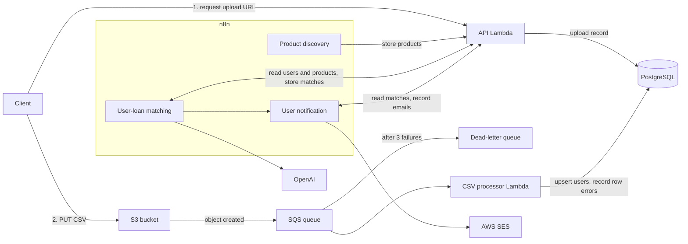

# LoanMatch

An event-driven backend that matches users to personal loan products. Users are bulk-imported from CSV files, loan products are collected by a scheduled workflow, and matches are produced by a three-stage pipeline: hard eligibility rules, weighted scoring, then LLM analysis of only the top candidates.

**Stack:** Go, Gin, AWS Lambda, API Gateway, S3, SQS, PostgreSQL, n8n, OpenAI, Serverless Framework

## Architecture



One Go binary serves both Lambda functions. `APP_MODE` selects `api` or `csv-processor`.

### Design decisions

- **Direct-to-S3 uploads.** The API only issues a pre-signed URL, so large files never pass through API Gateway or its payload limit.
- **Row-level failure isolation.** Rows are written in batches of 500, each row inside its own savepoint. A bad row is recorded in `csv_upload_errors` with its line number, and the rest of the batch still commits.
- **Idempotent imports.** Users are upserted by email, and duplicate queue deliveries for finished uploads are skipped.
- **LLM calls are limited.** Rules and scoring run first. Only the top 20% of matches (at most 50 per run) reach the model, which keeps costs bounded.

## Matching pipeline

| Stage | What it does |
| --- | --- |
| 1. Pre-filter | Rejects on minimum income, credit score, age range and employment type |
| 2. Scoring | Adjusts the score using EMI-to-income ratio, credit score band and interest rate |
| 3. AI analysis | Sends the top matches to the LLM for a refined score, insights and recommendations |

The matching logic lives in `n8n/workflows/user-loan-matching.json`.

## Project structure

```
src/
  main.go      Entry point, mode selection, routes, API key auth
  handlers/    HTTP and SQS handlers
  services/    CSV import, validation, S3 access
  database/    Connection pool and savepoint helper
  models/      Shared types
  utils/       Environment loading
migrations/    PostgreSQL schema
n8n/           Docker Compose setup and workflow exports
serverless.yaml  AWS infrastructure
```

## Running locally

Requires Go 1.21+ and Docker.

```bash
# 1. Start Postgres and apply the schema
docker run -d --name loanmatch-pg -e POSTGRES_PASSWORD=localpass -e POSTGRES_DB=loanmatch \
  -p 127.0.0.1:5432:5432 postgres:15
docker exec -i loanmatch-pg psql -U postgres -d loanmatch < migrations/001_init.sql

# 2. Configure
cp .env.example .env
```

Set these values in `.env`:

```
DATABASE_NAME=loanmatch
DATABASE_USER=postgres
DATABASE_PASSWORD=localpass
DATABASE_SSLMODE=disable
API_KEY=local-dev-key
```

```bash
# 3. Run the API on :8080
make run

# 4. Try it
curl localhost:8080/health
curl -H "X-API-Key: local-dev-key" localhost:8080/api/v1/n8n/loan-products
```

The CSV processor only runs on Lambda, because it consumes SQS events. Generating an upload URL locally needs `CSV_BUCKET_NAME` and AWS credentials in `.env`.

### n8n

```bash
cd n8n
cp .env.example .env   # fill in the passwords and API settings
docker compose up -d
```

Open http://localhost:5678 and import the files from `n8n/workflows/`. You also need to add OpenAI and AWS SES credentials in n8n.

## Deploying to AWS

Requires the Serverless Framework v4 and AWS credentials. Before deploying:

1. Replace the VPC security group and subnet IDs in `serverless.yaml` with your own.
2. Set the database variables and `API_KEY` in `.env`. Deployment fails if any required one is missing.
3. Apply `migrations/001_init.sql` to your database.
4. Make sure the VPC can reach S3, through an S3 gateway endpoint or a NAT gateway.

```bash
make deploy   # builds bootstrap and deploys the prod stage
```

## API

All `/api/v1` routes require an `X-API-Key` header. On Lambda the API refuses to start without `API_KEY`; locally, an empty key turns the check off.

| Method | Path | Purpose |
| --- | --- | --- |
| GET | `/health` | Health check (no key needed) |
| POST | `/api/v1/csv/initiate-upload` | Create an upload record and pre-signed URL |
| GET | `/api/v1/csv/upload/:upload_id/status` | Get import progress and row counts |
| POST | `/api/v1/n8n/trigger-matching` | Check that an upload finished and can be matched |
| GET | `/api/v1/n8n/users/new` | List users added in the last 24h, or since `?since=<RFC3339>` |
| GET | `/api/v1/n8n/loan-products` | List active loan products |
| POST | `/api/v1/n8n/loan-products` | Bulk upsert loan products |
| POST | `/api/v1/n8n/matches` | Bulk upsert user-loan matches |
| GET | `/api/v1/n8n/users/notification` | List users with eligible matches from the last hour |
| GET | `/api/v1/n8n/users/:user_id/matches` | List a user's eligible matches |
| POST | `/api/v1/n8n/notifications` | Record a sent notification |

### Importing users

```bash
# Get an upload URL
curl -X POST "$API_URL/api/v1/csv/initiate-upload" \
  -H "X-API-Key: $API_KEY" -H "Content-Type: application/json" \
  -d '{"filename": "users.csv", "uploaded_by": "admin"}'

# Upload the file. The Content-Type must match the signed URL.
curl -X PUT "$UPLOAD_URL" -H "Content-Type: text/csv" --data-binary @users.csv

# Check progress
curl -H "X-API-Key: $API_KEY" "$API_URL/api/v1/csv/upload/$UPLOAD_ID/status"
```

Columns are matched by header name and can be in any order:

| Column | Required | Rules |
| --- | --- | --- |
| `name` | Yes | |
| `email` | Yes | Valid email; used as the upsert key |
| `user_id` | No | UUID; generated if empty |
| `monthly_income` | No | 0 or more |
| `credit_score` | No | 300 to 900 (CIBIL range) |
| `employment_status` | No | `employed`, `unemployed`, `self-employed`, `student` or `retired` |
| `age` | No | 18 to 120 |

An upload finishes as `completed`, `partial` (some rows failed) or `failed`.

## Project status

The Go API and CSV import logic have been run against a real PostgreSQL database. These parts are not finished or not yet proven:

- **n8n workflows** have not been run end to end and may need adjusting after import.
- **Scrapers** in the product discovery workflow use placeholder CSS selectors, so they return no products until they are written for the real pages. Check each site's terms before scraping it.
- **The AWS deployment** of this version, including the S3 to SQS to Lambda path, has not been tested.
- **Automated tests** don't exist yet.
- **AI output** is parsed from free text rather than a schema-enforced format, and the workflow uses `gpt-3.5-turbo`.
- **Matching rules** live in n8n JavaScript, not in tested Go code.

## Security notes

- Keep secrets in `.env`, which is git-ignored and is not packaged into the Lambda.
- `API_KEY` is a single shared key, so there are no per-user permissions.
- The API stores personal and financial data. Use synthetic data for demos.
